<p align="center">
  
</p>

<h1 align="center">PDF Scholar</h1>

<p align="center"><strong>A PDF reader for research.</strong></p>

PDF Scholar is for documents you work through rather than skim: research articles, reports,
books. The window is nearly all page. One slim toolbar holds the tools, the contents and
assistant panels stay hidden until called, and the toolbar itself can be unpinned.

Four reading themes, and every file reopens where you stopped. Annotation starts from a
menu at the selected text; every mark is listed in a panel beside the document, and
comments can be shown in the margin or exported into one. A split view puts a figure or
table beside the passage that discusses it. Cross-references preview where they are
cited, and can be followed and returned from. The optional AI assistant answers from the
open document and cites the passage behind each claim. Free, MIT-licensed, and offline
unless you ask a question.

Runs on Windows and macOS, and as a browser extension for Edge and Chrome. A Linux build
is in beta.

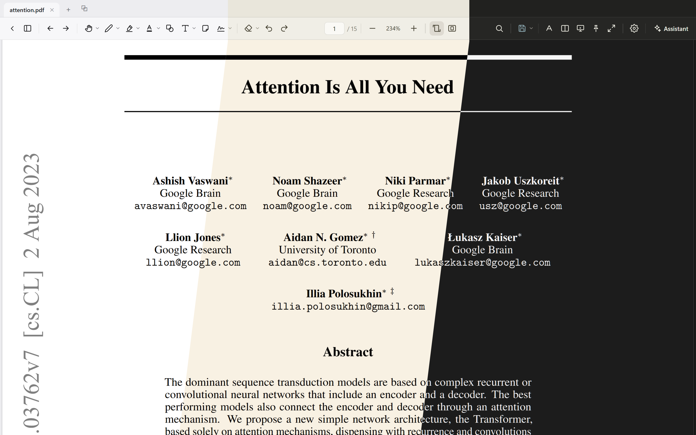

## Download

Two ways to run it: the desktop app, or a browser extension that opens PDFs inside Edge
or Chrome. Both use the same reader, annotator and assistant.

### Desktop app (Windows)

[](https://github.com/emilmsh/pdf-scholar/releases/latest)

**[⬇ Get PDF Scholar for Windows](https://github.com/emilmsh/pdf-scholar/releases/latest)** —
download `PDF-Scholar-Setup-*.exe` from the latest release and run it. Per-user install,
no admin rights. It registers as a PDF handler in Explorer and adds a "Recent" Jump List
to the taskbar. The installer carries both **x64 and native arm64** builds and picks the
right one, so Windows-on-ARM machines run native rather than emulated. Everything works
offline. The AI features need your own API key (Anthropic, OpenAI, Azure OpenAI,
OpenRouter, Google Gemini, Grok, Mistral or Groq), any OpenAI-compatible endpoint, or a
local model via Ollama or LM Studio with no key at all — entered in the assistant
settings. A ChatGPT Plus/Pro sign-in works instead of a key.

<sub>No install allowed on your machine? Each release also carries a **portable zip**
(`PDF-Scholar-*-portable-x64.zip`, and an `arm64` twin): extract it anywhere and run the
exe. Settings, recents and drafts live in a `data` folder beside it, so the folder moves
as a whole. It registers nothing, so it is not under "Open with" until you browse to it
once, and it reports new releases but cannot install them. AI keys are encrypted to the
Windows account that saved them and do not follow the folder to another machine.</sub>

[](https://apps.microsoft.com/detail/9N75CPC0G9M2)

**[⬇ Get PDF Scholar from the Microsoft Store](https://apps.microsoft.com/detail/9N75CPC0G9M2)** —
the same app as an MSIX package, x64 and arm64. The installer is updated more often.

### Desktop app (macOS)

The build is **not signed with an Apple Developer certificate** — deliberate, the app
has zero recurring costs. Two consequences for both paths below: Gatekeeper needs one
`xattr` command per installed version, and the app cannot install its own updates. It
still checks for them and, when one appears, shows the command or the download link
that matches how you installed it.

**With [Homebrew](https://brew.sh)** — recommended, since `brew upgrade` then delivers
new versions:

```sh
brew install --cask emilmsh/tap/pdf-scholar
xattr -cr "/Applications/PDF Scholar.app"
```

The second line is the Gatekeeper step; repeat it after each `brew upgrade`.

**By hand:** download the `.dmg` from the
[latest release](https://github.com/emilmsh/pdf-scholar/releases/latest) —
**`-arm64`** for Apple Silicon, **`-x64`** for Intel. Drag **PDF Scholar.app** into
**Applications** (not straight from the disk image), run the same `xattr` command, and
open it. New versions come from the releases page.

If Gatekeeper says *unverified developer* rather than "damaged", **Open Anyway** under
**System Settings → Privacy & Security** also works; the "damaged" variant has no such
button, so use the command.

Built in CI on every release and tested on Apple hardware. If something misbehaves on
your Mac, [open an issue](https://github.com/emilmsh/pdf-scholar/issues) with what works
and what breaks.

### Desktop app (Linux) — beta

From the [latest release](https://github.com/emilmsh/pdf-scholar/releases/latest):

- **Ubuntu/Debian:** the `.deb` (recommended — it registers the PDF file association,
  and Ubuntu 24.04+'s AppArmor policy blocks parts of the AppImage sandbox).
- **Other distros:** the `.AppImage` — `chmod +x` and run. No libfuse2 needed.

Both auto-update in place.

The build comes from the same sources as the Windows one, in CI, but has never been run
on a Linux machine: I develop on Windows and have no Linux hardware. The beta label is
literal. If you run it, [open an issue](https://github.com/emilmsh/pdf-scholar/issues)
with your distro and what worked or broke.

### Browser extension (Edge / Chrome)

The same viewer; each PDF opens as an ordinary browser tab instead of in the browser's
built-in reader. Make the browser your default PDF app and a double-click in Explorer
opens here too. To keep the browser's own handling of web PDFs — viewing or downloading
them as you have set it — switch off "Open PDFs from the web here" in the gear menu;
local files still open here.

[](https://microsoftedge.microsoft.com/addons/detail/pdf-scholar/jdmemepojgjhflpeckiiciibnhmbdjcc)
[](https://chromewebstore.google.com/detail/pdf-scholar/jhhlaaiegmdmjeeiopmdmoiidnbbhbmd)

**[⬇ Get it for Edge](https://microsoftedge.microsoft.com/addons/detail/pdf-scholar/jdmemepojgjhflpeckiiciibnhmbdjcc)**
or **[for Chrome](https://chromewebstore.google.com/detail/pdf-scholar/jhhlaaiegmdmjeeiopmdmoiidnbbhbmd)** —
one click, and updates arrive on their own. Store review takes time, so a listing can
trail the newest release by a version or two.

**By hand** — to run a build newer than the stores carry:

1. Download
   [`pdf-scholar-extension.zip`](https://github.com/emilmsh/pdf-scholar/releases/latest/download/pdf-scholar-extension.zip)
   and unzip it; it unpacks to one `pdf-scholar-extension` folder.
2. Open `edge://extensions` or `chrome://extensions` and turn on **Developer mode**.
3. **Load unpacked** → the `pdf-scholar-extension` folder.

Either way, opening local files (the Explorer double-click) needs one more toggle:
**Allow access to file URLs** on the extension's **Details** page. Only you can grant it,
so the extension asks once.

See [`docs/BROWSER-EXTENSION.md`](docs/BROWSER-EXTENSION.md) for the architecture and
the desktop-vs-extension parity.

## Features

### Undistracted reading

The frame at the top is one window in three of the four reading modes — the same page,
the same moment. Tint sets the page on a light paper tone (here the classic Sepia cream);
Night and Night+ are the two dark modes, the second with higher contrast.

- Smooth scrolling; zoom centres on the cursor or pinch point; one button toggles
  fit-width and whole-page (W)
- On Windows, PDF files get a document icon of their own in Explorer instead of the app
  logo. The settings menu offers quieter variants, with or without the app's mark, the
  logo, or your own .ico or square .png. In the extension the same menu sets the icon on
  the browser tab
- Four reading modes — Day, Tint, Night and Night+ — plus Auto, which follows the
  system setting. Tint is a light paper tone: Sepia cream, gray, green, blue or sand.
  Night has its own dark tones, or «White»: the page as printed, inside the dark chrome.
  Both take a strength slider (tint strength, or brightness for Night; 100 % is the
  standard look), and the toolbar and panels follow the tone. D cycles the modes
- Night can keep pictures in their original colours while the page inverts
- Copy a figure out of the page: "Copy image …" (right-click, or the save menu) outlines
  every picture in the document — click one to take it whole, or drag a box around a
  vector figure, a table or an equation. The capture is shown first, then copied to the
  clipboard or saved as PNG. A raster picture comes out at its own resolution, not its
  on-screen size
- Page rotation (Shift+R) and a two-page spread for wide layouts
- Page by page: one page — or one spread — at a time with space around it, turned by
  the wheel, a swipe or the arrow keys rather than scrolled; a zoomed-in page scrolls to
  its foot before it turns
- Presentation mode (P): one page at a time, full screen
- Unpin the toolbar (V) and the side panels go with it; each returns on hover at its
  window edge
- Table of contents, thumbnails and bookmarks (B) in one panel; the toolbar's page field
  jumps to a page number
- Internal links can be followed and returned from: back/forward (Alt+← / Alt+→, or the
  mouse side buttons) hold the history
- Internal links can be previewed where they are cited — citations, figures, tables and
  equations (see "Previews where you read")
- Reading positions and recent files are remembered. The library lists them as a list,
  or as a grid of first pages (three sizes) with how far you read each. Pin the ones you
  return to into a group of their own; remove the rest. Going back to the library closes
  nothing: open documents stay in the tab strip, and returning restores page, zoom and
  panels
- Several documents open in tabs or windows. Tabs can be pinned, and each window gets
  its tabs back at the next launch (a document is read only when its tab is shown).
  Ctrl+Shift+K, or "Duplicate tab" in the tab menu, opens a second tab on the same
  document; a mark made in either shows in both. A tab drags like a file: into another
  PDF Scholar window, or into anything that takes a PDF — an upload field, an e-mail, a
  chat, a folder — and along the bar to reorder. Ctrl+drag (Cmd on Mac) moves it inside
  the app instead: onto another window, or out onto the desktop for a window of its own
  ("Move to new window" in the tab menu does the same). A finger or pen always drags the
  in-app way
- Interface in Norwegian, English or Simplified Chinese; the choice also sets the AI
  prompts, exports and date formats. The Chinese is machine-translated from the English;
  corrections from native speakers are welcome as pull requests

### Previews where you read

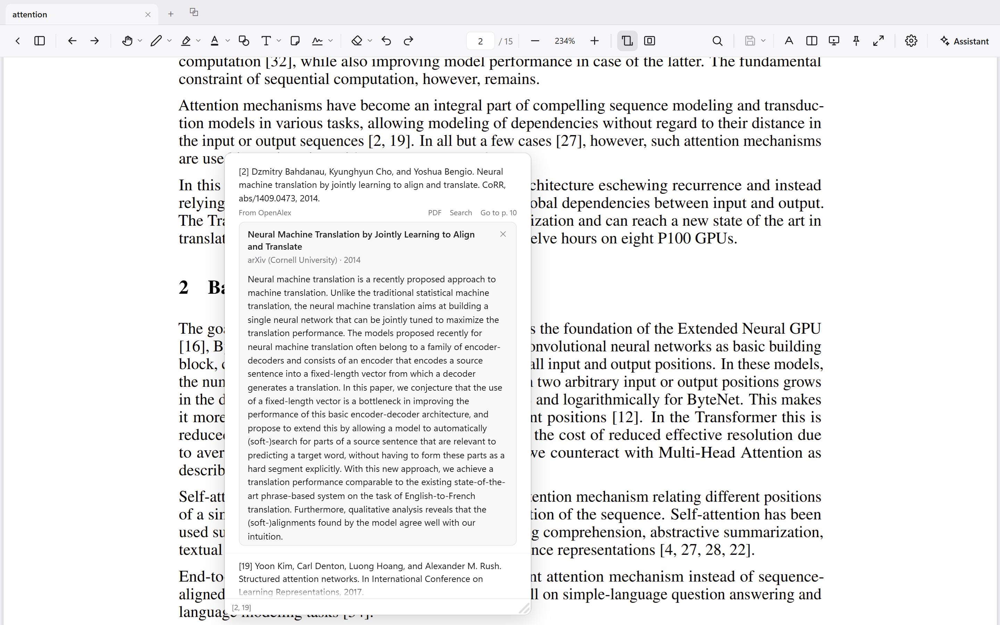

Rest the pointer on a citation, figure, table or equation reference and a preview of its
target opens beside the text, without moving the page (long-press on a touchscreen). A
citation shows its reference as text, as Zotero's reader does — selectable, its DOI and
web links live — and a bracketed citation like «[3, 5–9]» lists every reference in it,
whichever number the pointer rests on. Each has «Go to» for its place in the list
(Ctrl+click: the other column). A figure, table or equation gets a window onto its page:
scroll it, Ctrl+wheel to rescale, drag the corner to enlarge. Click inside to go there,
Ctrl+click to open it in the other column.

- On a citation, one click fetches the cited paper's abstract from free scholarly
  databases (arXiv, Europe PMC, Crossref, OpenAlex) — no key, no account, and only on
  that click; each reference in a bracket has its own. It folds out under the reference.
  In the reference list itself, select an entry and choose «Abstract» in the selection
  menu
- Roughly two in three citations find an abstract; books, working papers and some
  paywalled journals often do not
- "Preview links" in the settings menu turns previews off, or sets how long the pointer
  rests before one opens

### Two pages at once

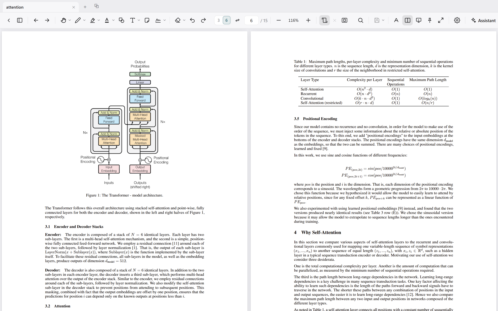

A table or figure often sits on one page and the text that discusses it on another. S
opens a second column of the same document. The column can also hold another document:
drag its tab into the view, pick it under "Open in split view" in the view menu
("Another file …" for one not yet open), right-click its tab, or drop a PDF on the
column. Two papers can then be read and annotated side by side; Shift+S swaps the sides.

- Each column has its own page, zoom and rotation, so a landscape table can sit upright
  beside portrait text
- The toolbar's page and zoom controls drive the active column. Annotation, eraser and
  undo work in either; a mark lands in the document it is made in, and with one document
  open it shows in both columns
- Ctrl+click on an internal link opens its target in the other column. Search, the
  outline, the notes list and the assistant's citations move only the active column, and
  back/forward history is per column
- A dropped tab or file lands on the column it hits, or, with one column open, on the
  half the pointer is over. Putting a column's document into the other column (its tab
  dropped there, or "Open in split view" on its own tab or name) fills both columns with
  it
- The divider can be dragged. S reopens whatever the split held last, the other document
  included, at its side and width; a closed same-file column comes back at its page, zoom
  and width
- The two-page spread pauses while the view is split and returns when the document is
  shown alone
- Two windows on the same file share one draft and stay in sync

### Annotating while you read

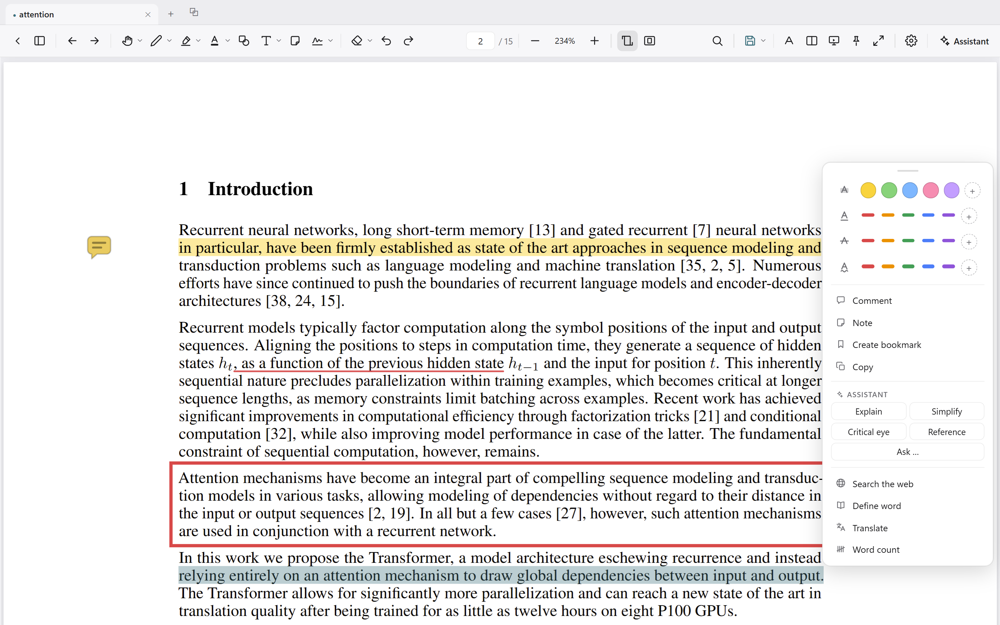

The tools appear at the text you select, and every mark is listed in a panel beside the
document.

- Selecting text opens the annotation menu: highlight, underline, strikeout and squiggly,
  a comment or a note, copy, dictionary, translate, and the assistant's actions on the
  selection. The toolbar carries the same tools for marking several passages in a row
- The notes panel lists every annotation by page, with search and colour, type and
  comment filters. Comments are edited in the list, and a click goes to the mark. A
  summary, highlighted text included, exports to Word, Markdown or HTML
- Comments in the margin: one switch lays every note and comment out as a card beside
  the page, left or right, colour-keyed to its mark, with a leader line to its passage
- Margin export: a copy of the document with every page widened and the comments set in
  the new margin as ordinary PDF annotations, numbered at their anchors. The original is
  untouched

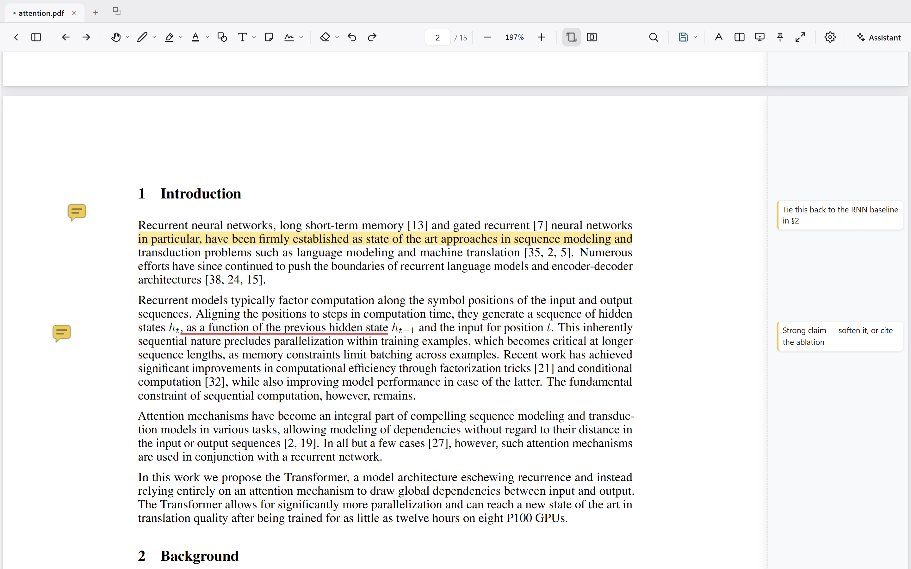
- Pen and marker with hold-to-straighten: hold still mid-stroke and the line straightens
- Shapes (rectangle, ellipse, line, arrow), draggable sticky notes, and free text typed
  on the page in the colour and size you pick
- With a stylus, the pen draws while a finger scrolls and zooms; pen pressure varies the
  line width *(beta)* and is kept in the saved file. A toggle in the tool menus hands
  drawing back to the finger
- The text tool uses the PDF standard typefaces — Helvetica, Times or Courier, bold and
  italic — and a size, chosen before typing or changed on an existing box. Nothing is
  embedded; the text stays searchable and renders the same in other readers
- A signature can be drawn once — mouse, pen or finger — or uploaded or pasted as an
  image, and stamped where needed. It is stored locally and saved as a standard stamp
  annotation. *Placing a signature is not digitally signing a document.* Where a file
  carries digital signatures, the app lists them and does not claim to verify them
- Password-protected documents open, can be annotated, and are saved with their
  protection intact
- Files attached to a document — a court filing's exhibits, a portfolio's files — are
  listed in the side panel and open or save from there; a paperclip on a page opens its
  file. Only document, data and media types open; anything that could run is saved,
  never launched. In the extension, attachments download instead
- Colour, thickness and opacity are set per tool and remembered; your own colours come
  from a colour wheel behind "+", in the selection menu and the toolbar's tool menus
  alike
- An optional name in settings fills the PDF author field on new annotations; left
  empty, they stay unsigned
- The eraser removes whole strokes, or can be set to remove any kind of annotation
- Any mark can be selected, moved, commented on and adjusted rather than redrawn: the
  ends of a highlight (snapping to whole words), or a corner of a shape, text box or
  drawing. Undo and redo cover everything (Ctrl+Z / Ctrl+Shift+Z)
- Edits are held in a draft until you save (Ctrl+S); closing prompts, and the draft
  survives a crash. What is saved is standard PDF annotations with appearance streams,
  which open in other readers. A guard warns before overwriting a file another program
  has changed

### Search by words or by meaning

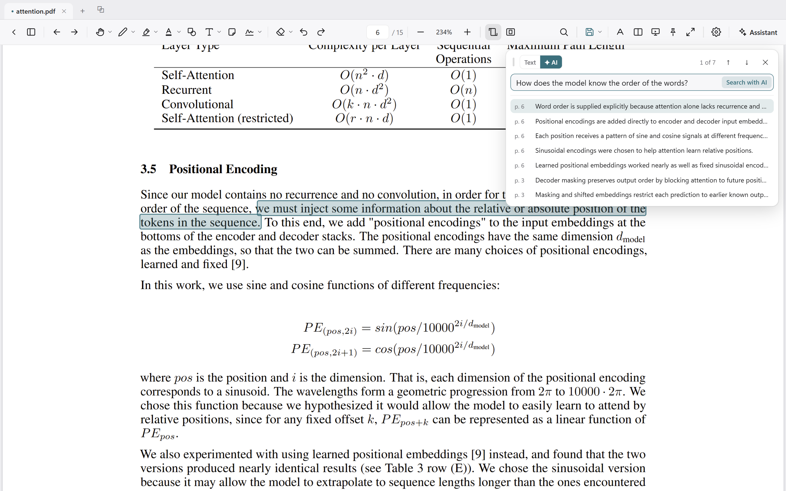

Both modes live in one search bar, a tab apart.

- By words (Ctrl+F): match case, whole word, a results list with excerpts, F3 / Shift+F3
  between hits, and every match marked on the page. The list opens folded so the bar
  never covers the hit it points at; unfold it and the choice is remembered. The bar can
  be dragged aside
- By meaning: describe a topic in your own words and get the passages that discuss it,
  ranked (uses the assistant's key)
- Scanned pages are searched too: a page that is only a picture of text — a scan, a
  reprint, a photocopied chapter — is read by text recognition on your own computer.
  From then on its words can be found, selected, copied, marked and asked about like any
  other page's. The pages on screen are read first; a search reads the rest and shows
  hits as they come. Nothing is sent anywhere and nothing is written into the file. The
  read is not perfect; now and then two short words come out joined
- The selection menu also offers copy, web search, dictionary and translation. It can
  wait for a right-click instead of opening on its own, and has a compact form with the
  same choices at a third of the height

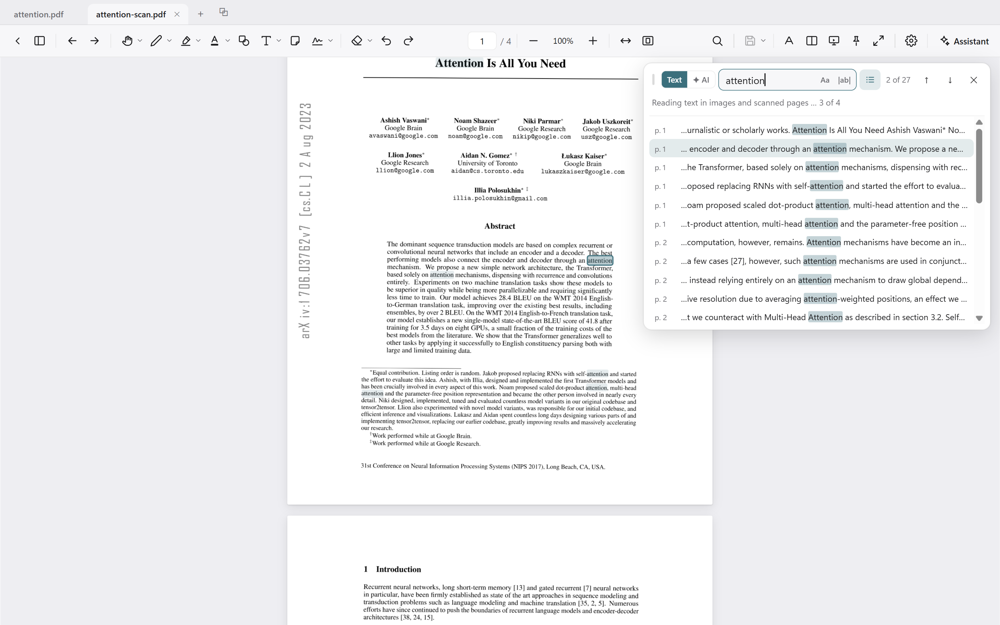

### An assistant that cites its sources

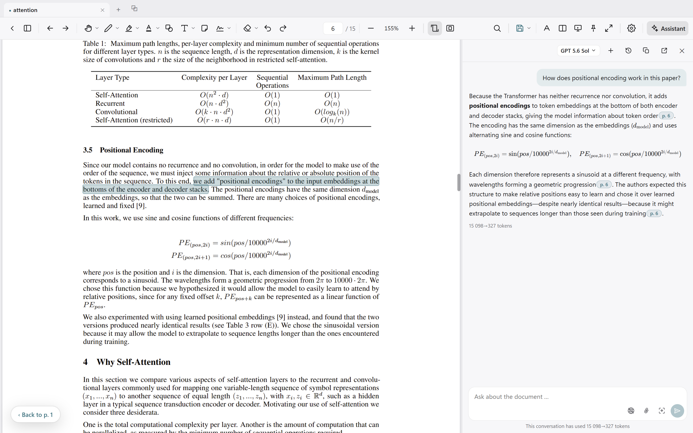

Optional, and it runs on your own API key — or on your ChatGPT plan. It answers from the
open document, and each claim carries a reference; following one goes to the sentence it
came from.

- Questions about a passage ("explain this simply", "what does this term mean here?"),
  or a structured article summary: research question, method, data, findings,
  limitations
- Questions about your own annotations: "summarize what I've highlighted"
- Context-menu actions on any selection: explain, simplify, critique, look up a cited
  reference, or a free-form question
- Explain a figure: drag a region around a chart or table and it lands in the chat as an
  attachment, staged until you press send. The one-click explain action in the selection
  menu is the exception and sends the crop as soon as it is drawn. Images can be pasted
  or attached the same way
- A scanned document is read the same way: the assistant gets the text recognised on
  your computer, with clickable citations, instead of only the pages you attach as
  images; the panel says so while the pages are being read
- Conversations are kept with their document. The library's Conversations view lists
  them across documents — searchable, sorted and filtered, each citation chip opening
  its passage — and an earlier conversation, about this paper or another, can be
  attached to a new question as context. A moved or renamed document keeps its
  conversations; old ones can be tidied in one go, and exported
- One paperclip in the composer attaches context to a question: an earlier conversation,
  an image, or a local file — a PDF or a text file (Markdown, CSV, JSON, LaTeX, BibTeX …)
  — whose text goes along as notes beside the document. A badge counts the attachments
  and the list shows them, each removable; the open document stays the only source the
  assistant cites
- The assistant can open in its own window, so the document keeps the whole screen or a
  second monitor carries the chat. A citation click still goes to the passage in the
  document's window, and raises it
- The answer text has its own size control (80–160 %), from the model menu or
  Ctrl+scroll over the panel, separate from the document's zoom
- Optional web search, off by default: switched on, the assistant searches when the
  question calls for it — outright or by implication — and never because the document
  says so (Anthropic and OpenAI keys). LaTeX in answers is rendered
- Providers: Anthropic (Claude, with native citations), OpenAI, Azure OpenAI,
  OpenRouter, Google Gemini, Grok (xAI), Mistral and Groq — one key field each — plus
  any OpenAI-compatible endpoint and local models via Ollama or LM Studio, which need no
  key. One menu holds every provider's models: a curated, verified list each, strongest
  first, with the provider's full live listing reachable by search. Requests go directly
  to the provider, with no server in between
- **Your ChatGPT plan instead of a key** (desktop app): sign in with ChatGPT Plus or Pro
  and the assistant runs on the plan's allowance — GPT-6 Astra, Sol and Luna, no API
  bill. It is an unofficial route (the same sign-in Codex and opencode use, which OpenAI
  allows today but can close), and ChatGPT's terms apply rather than the API's, so your
  account's model-training setting decides. The API-key provider stays alongside
- Each answer reports the token count the provider billed, and the key settings link to
  the provider's console, where a spending cap can be set

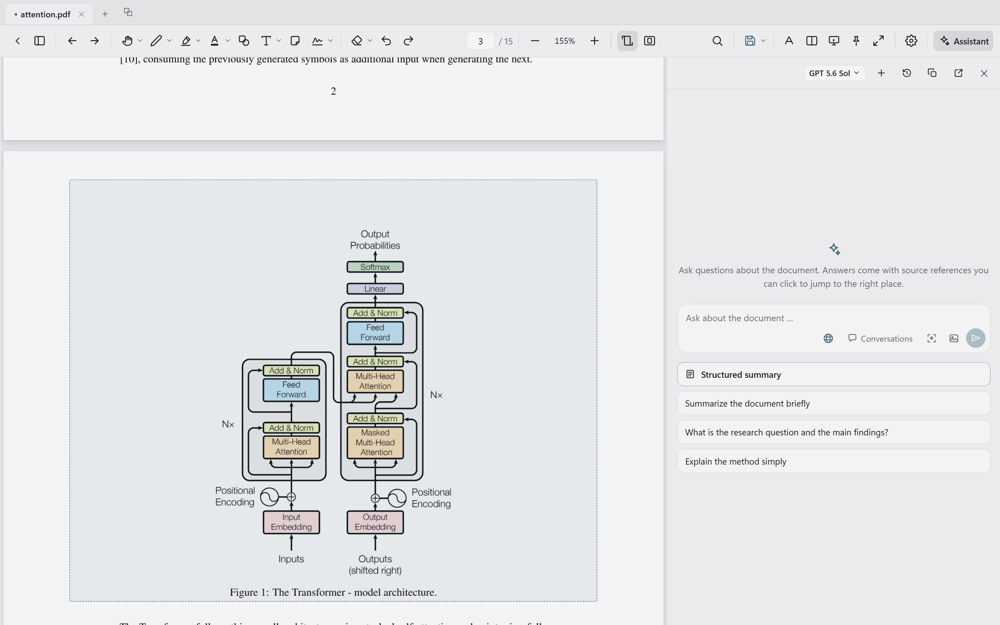

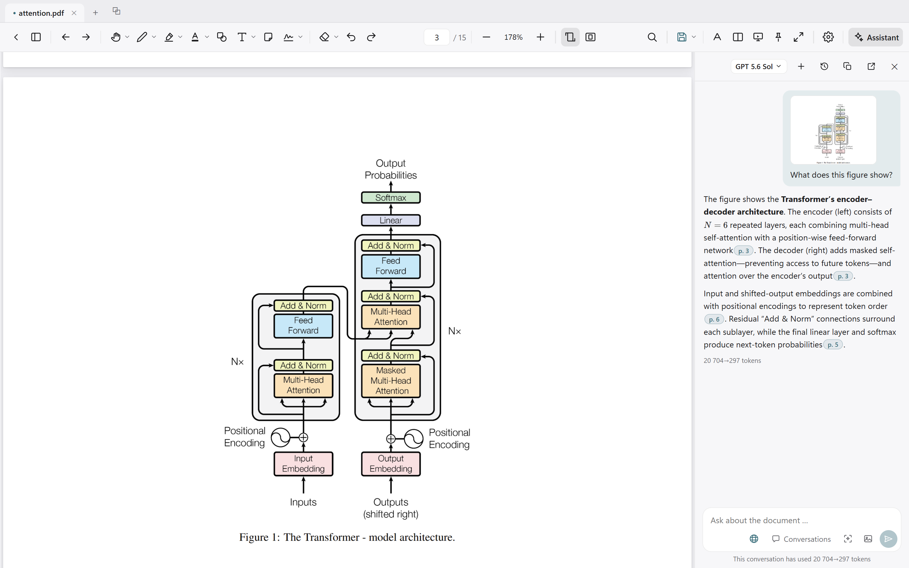

### Your notes in Claude Code and other AI tools

The desktop app can let an AI tool on your computer search what you noted across every
paper: highlights with the words they mark, comments, notes, and your assistant
conversations with the passages each answer cited. While you write, ask Claude Code what
you noted about a method, and it looks it up without opening a PDF.

- **Nothing to download.** The MCP server is part of the desktop app. In the assistant's
  settings, under "AI tools on this computer", **Claude Code** and **Claude Desktop**
  connect with one click
- **Codex, opencode, Cursor, VS Code, Gemini CLI** and other MCP tools take one config
  entry, which "Copy setup" fills in with your paths. Each tool's format is in
  [docs/MCP.md](docs/MCP.md)
- **ChatGPT** (and any other chat): "Copy for AI" in the Annotations tab copies the open
  document's notes and conversations as text, ready to paste. This also works in the
  browser extension
- Read-only: four tools (search, list papers, one paper's notes, one conversation).
  Tools never see the PDFs or images, and nothing from a password-protected document. The
  notes are kept up to date in the background as you annotate. AI access "Off" closes it

### Shortcuts you can rebind

Every command is listed in one map — Settings → Keyboard shortcuts — grouped by task,
with its keys beside it. Any shortcut can be rebound or reset, one or all at once; the
keys in this README are the defaults.

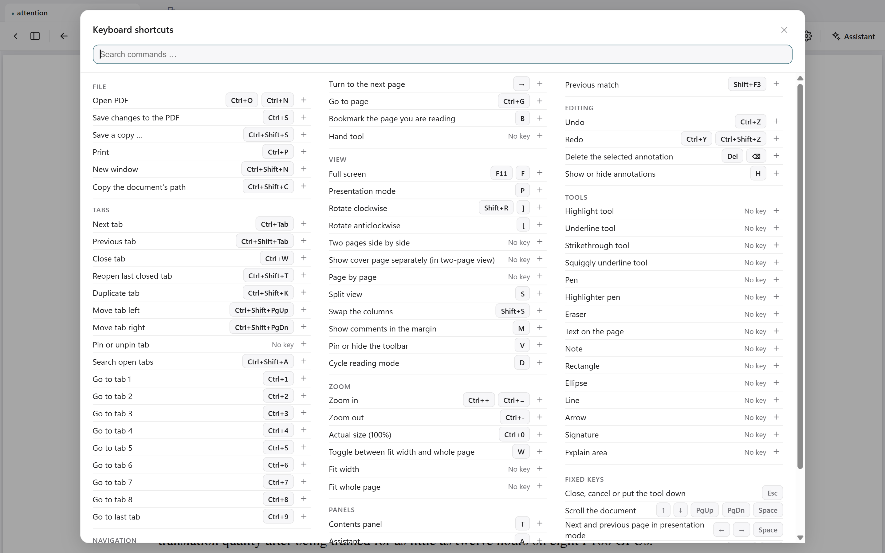

### Local by default

Reading, annotating and saving are local; the app runs without network access. Two
lookups go online, each on a click: a document's reference from doi.org, and a cited
paper's abstract from free scholarly databases (arXiv, Europe PMC, Crossref, OpenAlex).
Only the DOI, or the one reference entry, is sent. Assistant requests go directly to the
provider you chose, under your key and that provider's terms; there is no intermediary
server, and with a local model (Ollama, LM Studio) your questions stay on the machine
too.

An AI action sends document content — normally the whole text, an excerpt for very long
documents — and several actions fire on one click. An AI access switch in the
assistant's settings decides how far that goes. "Confirm before sharing" pauses the
first request that takes a document to a provider in a session, naming the model and
what is about to be attached, and lets follow-up questions about the same document pass;
a new document or a new provider asks again. "Off" blocks every AI request in the
transport layer, so a stored key cannot leak content by accident. It also makes the
server for outside AI tools refuse every request. A tool you connect reads your notes and
conversations, and what it reads goes to that tool's provider, under that tool's terms.

The key is pasted once, in the assistant's settings, and goes into the platform's key
store: DPAPI on Windows, Keychain on macOS, the system keyring on Linux. The browser
extension has no key store to reach and instead encrypts the key under a key no script
can read out. The settings panel names the case on your machine, and
[docs/PRIVACY.md](docs/PRIVACY.md) has the per-platform detail. A spending cap in the
provider's console is worth setting either way: no local storage can stop a program
already running as you from asking for the key to be decrypted.

### Working with Zotero

PDF Scholar works as an external reader for [Zotero](https://www.zotero.org/): under
General → "Open PDFs using", choose PDF Scholar, and library PDFs open here. Saved marks
are standard PDF annotations in the file itself, so Zotero's own reader shows them
(read-only, with a lock icon), and File → "Import Annotations…" converts the highlights
and underlines into native, editable Zotero annotations (text boxes and ink are not
importable on Zotero's side). Importing *moves* them: Zotero strips the annotations from
the file and keeps them in its database — its import dialog says so. If you keep reading
in PDF Scholar, skip the import: the annotations stay in the file, Zotero's reader still
shows them, and Zotero sync carries the annotated file to your other devices. Import when
you want to edit them in Zotero or extract them into a note, and use File → "Export
PDF…" if you later need a copy with them re-embedded.

A document in a Zotero library also gets a Zotero section in the save button's menu:
show the item in Zotero, or copy an in-text citation, a full reference or the BibTeX
entry. The style is a picker in that section — APA 7, Chicago (author-date or notes),
Harvard (Cite Them Right), IEEE, MLA 9, Nature or Vancouver, all shipped with Zotero —
and one choice serves every document. BibTeX comes from Zotero's built-in exporter, so
Better BibTeX is not needed; the citation key is Zotero's generated one, not a Better
BibTeX pinned key. Two fields are left out: `file`, which names the PDF's location on
your disk, and `abstract`, which belongs in the library rather than in a .bib file. The
metadata comes from Zotero's local API on your own machine — enable it once under
Settings → Advanced → "Allow other applications on this computer to communicate with
Zotero". Stored attachments are recognised by path alone, so "Show in Zotero" works for
them even with the API off. Linked attachments (a library kept in its own folder,
ZotFile-style) carry no item key in their path; they are matched by filename against the
library's attachment list through the same API, so their Zotero section appears while
Zotero runs with the API on.

A document outside your Zotero library can still be cited if it prints its DOI on the
first pages or carries it in its metadata, as most published papers do. The save menu
then shows a Reference section with the DOI and one row, "Fetch reference from doi.org".
Clicking it fetches the item's metadata (the Crossref or DataCite record, the same data
a citation manager imports) and turns it into an in-text citation, a reference in the
chosen style and a BibTeX entry (for numeric styles like IEEE the in-text row stays
empty, since the number depends on your bibliography's order). That click is the only
time anything leaves your machine, and only the DOI is sent. When Zotero knows the
document, its section takes precedence — your corrected metadata beats the publisher's
deposit — so you never see two versions of one citation.

## Development

```bash
npm install
npm run dev        # full Electron app with HMR
npm run dev:web    # renderer only, in a plain browser on :5199
npm run typecheck  # tsc for renderer, main/preload and the extension
npm run dist       # NSIS installer (Windows)
npm run build:ext  # browser-extension bundle → dist-extension/
npm run ext:local  # same build, mirrored into the folder your browser loaded unpacked
npm run test:windows  # two windows on one file, end to end (needs npm run build first)
npm run shoot         # drive the app into each documented state and photograph it
npm run check:shots   # which shipped screenshots predate the visual changes
```

`npm run shoot` and `npm run test:windows` drive the real desktop app over Chromium's
DevTools protocol, which Electron ships, so neither needs a browser-automation
dependency. Both run in a throwaway profile with factory defaults and leave your
recents, reading positions and theme alone.

Every shot asserts its state before capturing, so a renamed tooltip or a jump that
never happened fails the run instead of saving a wrong picture; `shoot` is a UI smoke
test as much as a camera. `--list` shows the shot names; pass names to run a subset. The
assistant shots replay an answer recorded once into `docs/ai-fixtures/`, so an ordinary
run needs no API key; only the provider call comes from disk, while the chips, the jump
to the cited sentence, the highlight and the snipped region run live. `--with-ai` calls
the real provider with your own key, and `--record` refreshes the recording.

Shots land in the gitignored `docs/screenshots/_auto/`; the images in this README are
picked by hand. `npm run check:shots` reports which shipped images predate the visual
changes since — see [`docs/RELEASE.md`](docs/RELEASE.md).

`npm run test:windows` opens a second window on the same file, annotates in both, saves
from one, and verifies the result with mupdf — a different PDF implementation, so it
cannot share a bug with our writer. It covers the overlay, the IPC, main's shared draft,
the reload in the other window, and the bytes on disk.

Architecture in short: **pdf.js v6 renders, EmbedPDF (PDFium WASM) writes.** The React
renderer draws annotations in its own overlay, not pdf.js's editor layer. The Electron
main process owns the annotation engine, the AI providers and the draft-based save
model. Every platform call goes through one interface (`PdfxApi`), so one renderer
serves the desktop app, the browser extension and the plain-browser dev preview. See
`CLAUDE.md` and `docs/ROADMAP.md` for the details and the road ahead.

## Status

Actively developed, by someone who reads PDFs for a living. Installers are attached to
the [GitHub releases](https://github.com/emilmsh/pdf-scholar/releases), and
[`docs/PLATFORMS.md`](docs/PLATFORMS.md) lists what each platform supports today.

## Citing

If PDF Scholar was useful in your research, a citation is appreciated — use GitHub's
**Cite this repository** button, backed by [`CITATION.cff`](CITATION.cff).

## License

PDF Scholar is licensed under the **[MIT License](LICENSE)**. Every bundled component is
permissively licensed: annotations are written by
[EmbedPDF](https://www.embedpdf.com/)'s PDFium build (MIT / BSD-3-Clause), rendering by
[pdf.js](https://mozilla.github.io/pdf.js/) (Apache-2.0), text on scanned pages by
[Tesseract](https://github.com/tesseract-ocr/tesseract) through
[tesseract.js-core](https://github.com/naptha/tesseract.js-core) and its trained models
(all Apache-2.0), plus [Electron](https://www.electronjs.org/) (MIT),
[React](https://react.dev/) (MIT), the
[Anthropic SDK](https://github.com/anthropics/anthropic-sdk-typescript) (MIT) and the
[Libertinus](https://github.com/alerque/libertinus) wordmark font (SIL OFL 1.1). Text
boxes are set in the PDF standard fonts, which every reader already has — nothing is
embedded in the documents you save. ([mupdf](https://mupdf.com/), AGPL, is used only as
a development-time test verifier and ships with no release build.)

---

<sub>Built by [Emil Mathias Strøm Halseth](https://emilmsh.github.io/), who reads
PDFs for a living, with assistance from [Claude Code](https://claude.com/claude-code).
Logo by [Elisabeth Walle](https://www.linkedin.com/in/elisabeth-walle-239028140/).</sub>
