<p align="center">
  
</p>

<h1 align="center">PDF Scholar</h1>

<p align="center"><strong>A PDF reader for research.</strong></p>

<p align="center">
Read, annotate and search papers, with split view, link previews and an optional AI
assistant that cites its sources.
</p>

<p align="center">
<a href="https://emilmsh.github.io/pdf-scholar/">Website</a> ·
<a href="#download">Download</a> ·
<a href="#features">Features</a> ·
<a href="#local-by-default">Privacy</a>
</p>

- **Free.** MIT-licensed. No account, ads or tracking.
- **Local.** Reading and annotating work offline.
- **Windows, macOS, Linux.** The same desktop app on all three.
- **Edge and Chrome.** The same reader as a browser extension.

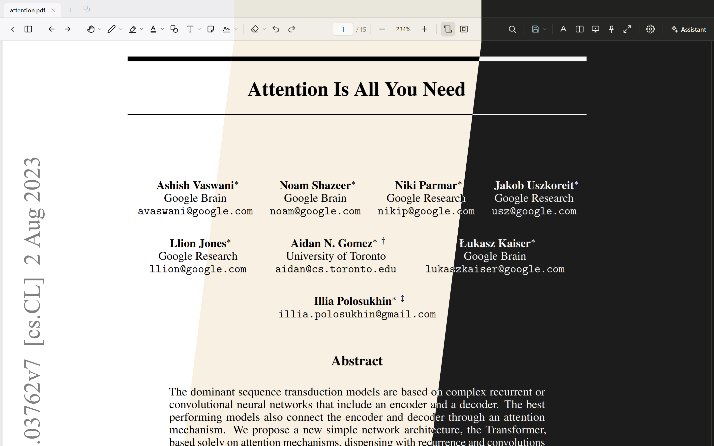

## Download

| | |
| --- | --- |
| **Windows** | [Installer](https://github.com/emilmsh/pdf-scholar/releases/latest) · [Microsoft Store](https://apps.microsoft.com/detail/9N75CPC0G9M2) · portable zip |
| **macOS** | [Homebrew](#macos) · `.dmg` for Apple Silicon or Intel |
| **Linux** | `.deb` · `.AppImage` |
| **Browser extension** | [Edge Add-ons](https://microsoftedge.microsoft.com/addons/detail/pdf-scholar/jdmemepojgjhflpeckiiciibnhmbdjcc) · [Chrome Web Store](https://chromewebstore.google.com/detail/pdf-scholar/jhhlaaiegmdmjeeiopmdmoiidnbbhbmd) |

The files are on the [latest release](https://github.com/emilmsh/pdf-scholar/releases/latest).

### Windows

`PDF-Scholar-Setup-*.exe` installs per user, with no admin rights, and carries x64 and
native arm64 in one file. It registers as a PDF handler in Explorer and adds a "Recent"
Jump List to the taskbar. The [Microsoft Store](https://apps.microsoft.com/detail/9N75CPC0G9M2)
has the same app as an MSIX package; the installer is updated more often.

<sub>Without an installer: `PDF-Scholar-*-portable-x64.zip` (or `-arm64`), extracted
anywhere. Settings, recents and drafts live in a `data` folder beside the exe, so the
folder moves as a whole. It registers nothing, so it is not under "Open with" until you
browse to it once; it reports new releases but cannot install them; and AI keys are
encrypted to the Windows account that saved them.</sub>

### macOS

The build is not signed with an Apple Developer certificate, since the project has no
recurring costs. Gatekeeper therefore needs one `xattr` command per installed version, and
the app cannot install its own updates. It checks for them and shows the command or link
that matches how you installed it.

**With [Homebrew](https://brew.sh)**, so `brew upgrade` delivers new versions:

```sh
brew install --cask emilmsh/tap/pdf-scholar
xattr -cr "/Applications/PDF Scholar.app"
```

Repeat the second line after each `brew upgrade`.

**By hand:** download the `.dmg` (`-arm64` for Apple Silicon, `-x64` for Intel), drag
**PDF Scholar.app** into **Applications**, run the same `xattr` command, and open it.

If Gatekeeper says *unverified developer*, **Open Anyway** under **System Settings →
Privacy & Security** also works. The "damaged" message has no such button; use the
command.

### Linux

- **Ubuntu and Debian:** the `.deb`. It registers the PDF file association, and Ubuntu
  24.04's AppArmor policy blocks parts of the AppImage sandbox.
- **Other distros:** the `.AppImage`; `chmod +x` and run. No libfuse2 needed.

Both update in place. The build comes from the same sources as the Windows one. I develop
on Windows and have no Linux machine, so
[an issue](https://github.com/emilmsh/pdf-scholar/issues) naming your distro and what
worked is useful.

### Browser extension

The same reader, annotator and assistant. PDFs open in an ordinary browser tab, and with
the browser as your default PDF app, a double-click in Explorer opens here too. "Open PDFs
from the web here" in the gear menu turns the web half off, so the browser handles web
PDFs as before.

To open local files, switch on **Allow access to file URLs** on the extension's
**Details** page; the extension asks once.

The store listings can trail the newest release while an update is in review. To run the
newest build, download
[`pdf-scholar-extension.zip`](https://github.com/emilmsh/pdf-scholar/releases/latest/download/pdf-scholar-extension.zip),
unzip it, turn on **Developer mode** under `edge://extensions` or `chrome://extensions`,
and choose **Load unpacked** on the folder. [`docs/BROWSER-EXTENSION.md`](docs/BROWSER-EXTENSION.md)
has the architecture and what differs from the desktop app.

## Features

| | |
| --- | --- |
| [Reading](#undistracted-reading) | One slim toolbar; the rest of the window is the page. Four reading themes, tabs, and a library that reopens each file where you stopped. |
| [Link previews](#previews-where-you-read) | Hover a citation, figure, table or equation reference to see its target beside the text. One click fetches a cited paper's abstract. |
| [Split view](#two-pages-at-once) | Two columns of one document, or two documents side by side, each with its own page and zoom. |
| [Annotation](#annotating-while-you-read) | Highlight, underline, comment, draw and type. Saved as standard PDF annotations that open in other readers. |
| [Zotero](#works-with-zotero) | Works as Zotero's external reader. Copy a citation, reference or BibTeX entry from the save menu. |
| [Search](#search-by-words-or-by-meaning) | By words, or by meaning: describe a topic and get the passages that discuss it. |
| [Scanned pages](#scanned-pages-have-text) | Text recognition runs on your computer and makes scans searchable and selectable. |
| [Assistant](#an-assistant-that-cites-its-sources) | Optional. Runs on your API key, a ChatGPT plan or a local model. Each claim links to the passage it came from. |
| [Notes in AI tools](#your-notes-in-claude-codex-and-other-ai-tools) | Claude, Codex and other MCP tools can search your highlights, comments and conversations. Off by default. |

The keys below are the defaults; every shortcut can be rebound.

### Undistracted reading

One slim toolbar holds the tools you use often; contents, notes and the assistant are side
panels you open when needed. Unpinned (V), the toolbar hides and the page fills the
window; the toolbar and panels return on hover at the window edges.

- Four reading modes and Auto, which follows the system. Day is white paper; Tint is a
  light paper tone (Sepia cream, gray, green, blue, sand or a colour of your own); Night
  and Night+ are dark, the second with higher contrast. Night has its own dark tones, or
  "White": the page as printed inside the dark chrome. A slider sets the strength, the
  toolbar follows the tone, and D cycles the modes
- Night can keep figures and photos in their original colours
- Zoom centres on the cursor or pinch point; W toggles fit-width and whole page. Pages
  can be rotated (Shift+R), shown as a two-page spread, turned page by page, or
  presented full-screen (P)
- Contents, thumbnails and bookmarks (B) in one panel. The toolbar's page field jumps to a
  page; back and forward (Alt+← / Alt+→, or the mouse side buttons) hold the history
- Documents open in tabs or separate windows, and each window gets its tabs back at the
  next launch. Tabs can be pinned, grouped and duplicated (Ctrl+Shift+K). A tab drags like
  a file into another window, an upload field or an e-mail; Ctrl+drag (Cmd on Mac) moves
  it inside the app instead
- The library lists recent files, or shows their first pages with how far you read. Every
  file reopens on the page where you stopped, and going back to the library closes
  nothing
- "Copy image …" outlines every picture in the document: click one to take it whole, or
  drag a box around a vector figure, table or equation, then copy it or save it as PNG
- Password-protected documents open, take annotations and are saved with their protection
  intact. Files attached to a document are listed in the side panel; only document, data
  and media types open from there, and anything that could run is saved instead
- On Windows, PDF files get a document icon of their own in Explorer, with quieter
  variants or your own .ico or .png in the settings menu
- The interface is in English, Norwegian and Simplified Chinese, and the choice also sets
  the AI prompts, exports and dates. The Chinese is machine-translated; corrections are
  welcome as pull requests

### Previews where you read

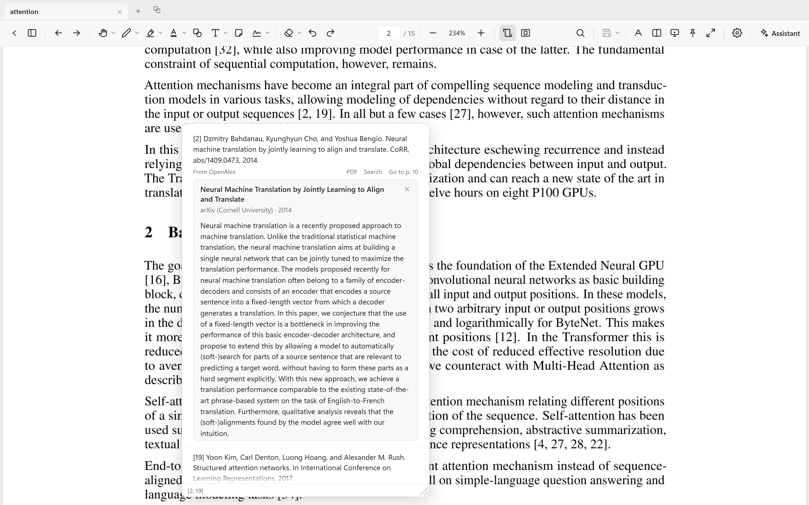

Rest the pointer on a citation, figure, table or equation reference (long-press on a
touchscreen), and its target opens in a small window beside the text.

- A citation shows its reference as selectable text with live DOI and web links. A
  bracket like «[3, 5–9]» lists every reference in it, each with "Go to" for its place in
  the list
- One click fetches the cited paper's abstract from arXiv, Europe PMC, Crossref or
  OpenAlex. Roughly two in three citations find one; books, working papers and some
  paywalled journals often do not. In the reference list itself, select an entry and
  choose "Abstract"
- A figure, table or equation opens in a window you can scroll, rescale (Ctrl+wheel) and
  resize. Click to go there, Ctrl+click to open it in the other column
- "Preview links" in the settings menu turns previews off or sets the delay

### Two pages at once

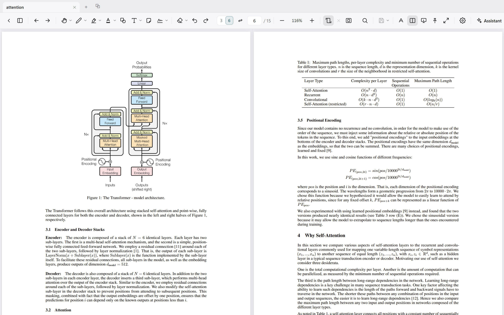

S opens a second column, showing the same document or another one.

- Each column has its own page, zoom and rotation: a landscape table can sit upright
  beside the text that discusses it. The divider drags, and Shift+S swaps the sides
- Ctrl+click on an internal link opens its target in the other column. Search, the
  outline, the notes list and the assistant's citations move the active column
- To read two papers side by side, drag a tab into the view, drop a PDF on it, or choose
  "Open in split view" in the view menu. Each column annotates its own file; with one
  document, a mark shows in both
- S reopens whatever the split held last, at its side and width
- Two windows on the same file share one draft and stay in sync

### Annotating while you read

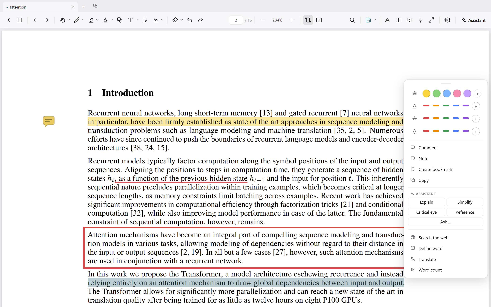

Selecting text opens the annotation menu at the selection: highlight, underline,
strikeout, squiggly, comment, or ask the assistant. The toolbar adds a pen, shapes, text
boxes and a signature stamp; with a stylus, the pen draws while a finger scrolls.

- A notes panel lists every mark by page, with search and colour, type and person
  filters. Comments are edited in the list, and a summary exports to Word, Markdown or
  HTML
- Comments can be shown in the margin beside the page, each with a line to its passage,
  and exported as a print-ready copy with the comments set in a widened margin

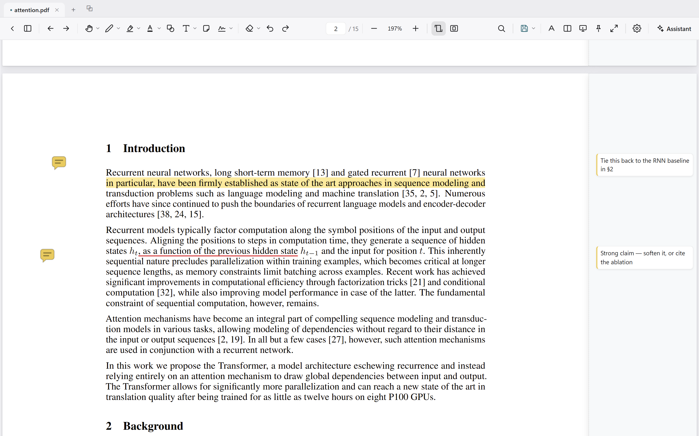

- Pen and marker straighten when you hold still mid-stroke. Pen pressure varies the line
  width and is kept in the saved file
- The text tool uses the PDF standard typefaces (Helvetica, Times, Courier, bold and
  italic), so the text stays searchable and looks the same in other readers
- A signature is drawn once, or uploaded as an image, and stamped where needed. Placing
  one is not digitally signing the document; where a file carries digital signatures, the
  app lists them and does not verify them
- Colour, thickness and opacity are set per tool and remembered, with your own colours
  from a colour wheel
- Marks can be moved and adjusted: the ends of a highlight snap to whole words, and shapes,
  text boxes and drawings resize by their corners. Undo and redo cover everything
- Edits are held in a draft until you save (Ctrl+S), and the draft survives a crash. What
  is saved is standard PDF annotations, which open in other readers

### Works with Zotero

Under General → "Open PDFs using" in Zotero 7 or later, choose PDF Scholar, and library
PDFs open here.

- A document from a Zotero library gets a Zotero section in the save menu: show the item
  in Zotero, or copy its in-text citation, reference or BibTeX entry in one of eight
  styles (APA 7, Chicago author-date or notes, Harvard, IEEE, MLA 9, Nature, Vancouver).
  The data comes from Zotero's local API, which you enable once under Settings →
  Advanced → "Allow other applications on this computer to communicate with Zotero".
  Linked attachments are matched by filename while Zotero runs
- The BibTeX comes from Zotero's built-in exporter, without the `file` and `abstract`
  fields. Better BibTeX is not needed
- Zotero's own reader shows the marks saved in the file. File → "Import Annotations…"
  turns highlights and underlines into Zotero annotations, and moves them out of the file
  into Zotero's database. If you keep reading here, skip the import
- A document outside Zotero that prints its DOI gets a Reference section instead: one
  click fetches its reference and BibTeX from doi.org, sending only the DOI

### Search by words or by meaning

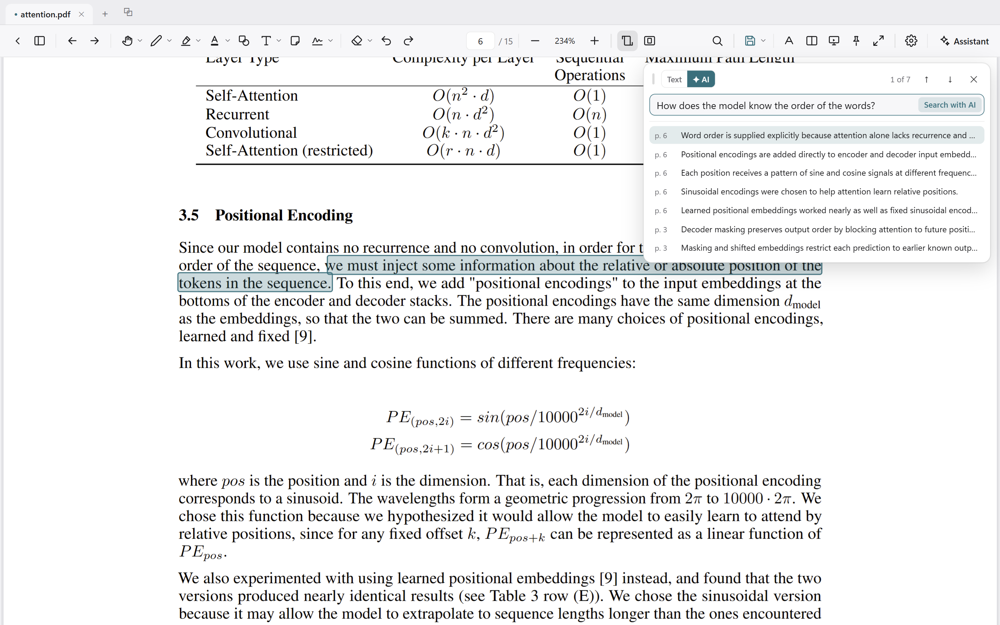

One search bar with two modes.

- By words (Ctrl+F): match case or whole word, a results list with excerpts, F3 /
  Shift+F3 between hits, and every match marked on the page. The bar can be dragged aside
- By meaning: describe a topic in your own words and get the passages that discuss it,
  ranked. This mode uses the assistant's key

### Scanned pages have text

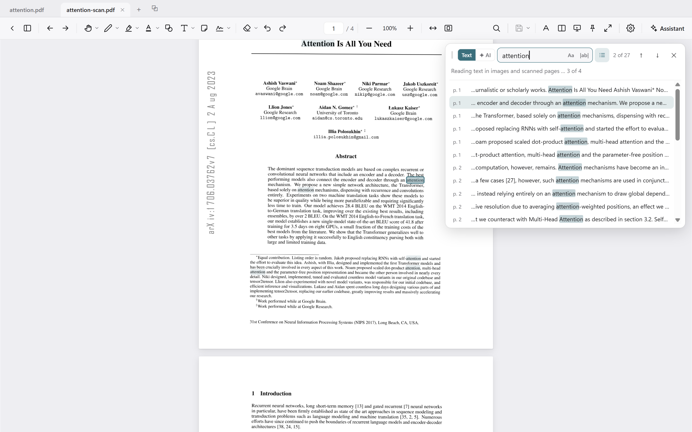

Scans, reprints and photocopied chapters are read by text recognition on your computer.
Their words can then be searched, selected, copied, marked and asked about.

- The pages on screen are read first; a search reads the rest and shows the hits as they
  come
- The recognised text stays on your computer, and the file is left unchanged
- Models for English, Norwegian and Simplified Chinese. The read is not perfect: now and
  then two short words come out joined

### An assistant that cites its sources

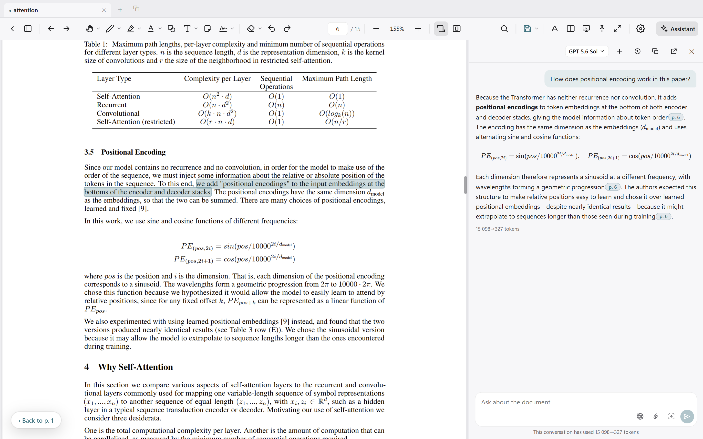

Optional. Each claim in an answer carries a reference, and clicking it goes to the passage
the claim came from.

- Ask about the document, a passage, your own highlights ("summarize what I've
  highlighted"), or a structured summary: research question, method, data, findings,
  limitations. The selection menu adds explain, simplify, critique and a free question
- Drag a box around a figure or table and it lands in the chat, staged until you send.
  Images can be pasted the same way. A scanned document is read from its recognised text,
  with the same clickable citations

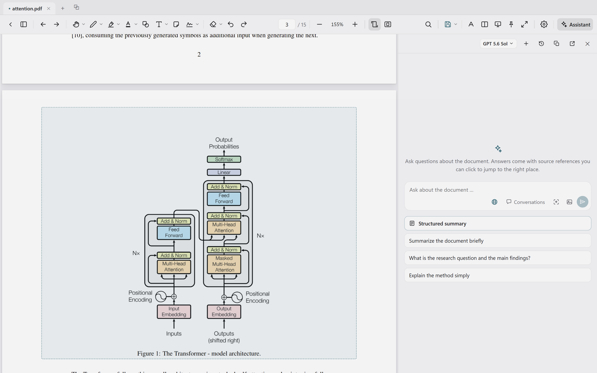

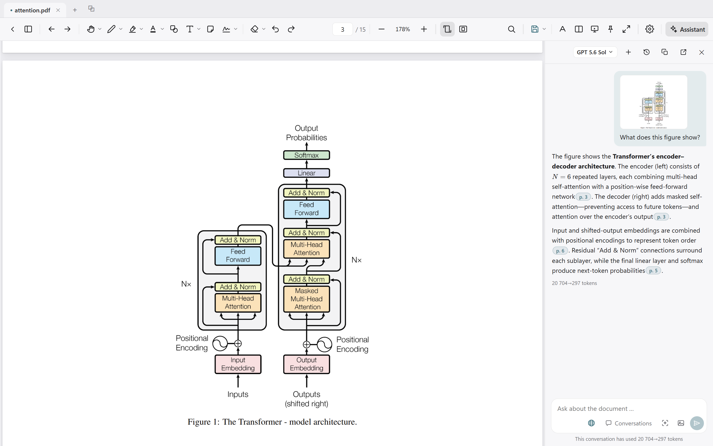

- Conversations are kept with their document and listed in the library, searchable. A
  paperclip attaches an earlier conversation, an image or a local file (PDF, Markdown,
  CSV, LaTeX, BibTeX …) as context; the open document stays the only source the assistant
  cites
- The assistant can open in its own window, so the document keeps the whole screen. The
  answer text has its own size, and LaTeX is rendered. Web search is optional and off by
  default (Anthropic and OpenAI)
- Providers: OpenAI, Claude (Anthropic), Google Gemini, Azure OpenAI, OpenRouter, Grok
  (xAI), Mistral and Groq with your own key, or any OpenAI-compatible endpoint, including
  local models through Ollama or LM Studio with no key. The model menu lists a curated set
  per provider, and each answer reports the provider's token count
- Signing in with ChatGPT Plus or Pro in the desktop app runs the assistant on the plan's
  allowance; the browser extension uses that sign-in when the app is installed. It is an
  unofficial route that OpenAI allows today, the same one Codex and opencode use, under
  ChatGPT's terms

### Your notes in Claude, Codex and other AI tools

The desktop app can let an AI tool on your computer search what you noted across every
paper: highlights with the words they mark, comments, and your assistant conversations.

- The MCP server is part of the app. Claude and Codex each have a switch under "AI tools"
  in the settings menu, which writes PDF Scholar into that tool's settings. Other tools
  that support MCP take one config entry, which the app copies for you
  ([docs/MCP.md](docs/MCP.md)). In the ChatGPT app, use Codex: an ordinary ChatGPT chat
  runs in OpenAI's cloud and cannot reach your computer
- Read-only: search, list papers, one paper's notes, one conversation. Every switch is off
  until you turn it on. A document or a whole folder can be kept out, and a tool never
  sees the PDFs, images, file paths or anything from a password-protected document
- For a tool that cannot connect, "Copy for AI" in the Annotations tab copies one
  document's notes and conversations as text to paste. This also works in the browser
  extension

### Shortcuts you can rebind

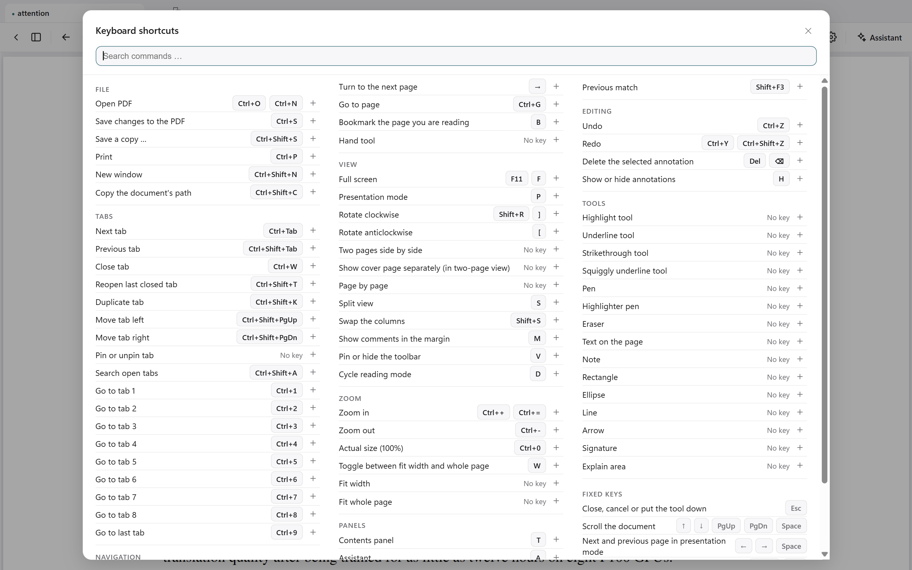

Every command is listed in one map in settings, grouped by task, with its keys beside it.
Any shortcut can be rebound or reset, one key or all at once.

### Local by default

- **Reading and annotating.** Reading, annotating and saving are entirely local. The app
  runs without network access
- **Two lookups.** A document's reference from doi.org and a cited paper's abstract from
  free scholarly databases go online, each on a click. Only the DOI, or the one reference
  entry, is sent
- **The assistant.** Requests go directly to the provider you chose, under your key and
  that provider's terms, with no intermediary server; with a local model, questions stay
  on your machine. An AI action sends document content: normally the whole text, an
  excerpt for very long documents. "Confirm before sharing" in the assistant's settings
  asks before a document is first shared with a provider, naming the model; "Off" blocks
  every AI request
- **AI tools.** An AI tool you turn on reads your notes and conversations, and what it
  reads goes to that tool's provider. Its switch takes that back
- **Keys.** API keys go into the platform's key store: DPAPI on Windows, Keychain on
  macOS, the system keyring on Linux. The browser extension encrypts the key itself, and
  the settings panel names the case on your machine. A spending cap in the provider's
  console is worth setting either way

[docs/PRIVACY.md](docs/PRIVACY.md) has the per-platform detail.

## Development

```bash
npm install
npm run dev        # full Electron app with HMR
npm run dev:web    # renderer only, in a plain browser on :5199
npm run typecheck  # tsc for renderer, main/preload and the extension
npm run dist       # NSIS installer (Windows)
npm run build:ext  # browser-extension bundle → dist-extension/
npm run ext:local  # same build, mirrored into the folder your browser loaded unpacked
npm run test:windows  # two windows on one file, end to end (needs npm run build first)
npm run shoot         # drive the app into each documented state and photograph it
npm run check:shots   # which shipped screenshots predate the visual changes
```

`npm run shoot` and `npm run test:windows` drive the built desktop app over Chromium's
DevTools protocol, in a throwaway profile with factory defaults. Every shot checks its
state before capturing, so `shoot` doubles as a UI smoke test. The assistant shots replay
an answer recorded in `docs/ai-fixtures/`, so no API key is needed (`--with-ai` calls the
real provider, `--record` refreshes the recording). Shots land in the gitignored
`docs/screenshots/_auto/`; the shipped images are picked by hand
([`docs/RELEASE.md`](docs/RELEASE.md)).

`npm run test:windows` annotates in two windows on one file, saves from one, and checks
the result with mupdf, an independent PDF implementation.

**pdf.js renders, EmbedPDF (PDFium WASM) writes.** The React renderer draws annotations in
its own overlay. The Electron main process owns the annotation engine, the AI providers
and the draft-based save. Every platform call goes through one interface (`PdfxApi`), so
one renderer serves the desktop app, the browser extension and the plain-browser preview.
`CLAUDE.md` and `docs/ROADMAP.md` have the details;
[`docs/PLATFORMS.md`](docs/PLATFORMS.md) lists what each platform supports.

## Citing

If PDF Scholar was useful in your research, GitHub's **Cite this repository** button gives
a citation from [`CITATION.cff`](CITATION.cff).

## License

[MIT](LICENSE). Every bundled component is permissively licensed: annotations are written
by [EmbedPDF](https://www.embedpdf.com/)'s PDFium build (MIT / BSD-3-Clause), rendering by
[pdf.js](https://mozilla.github.io/pdf.js/) (Apache-2.0), text on scanned pages by
[Tesseract](https://github.com/tesseract-ocr/tesseract) through
[tesseract.js-core](https://github.com/naptha/tesseract.js-core) and its trained models
(Apache-2.0), plus [Electron](https://www.electronjs.org/) (MIT),
[React](https://react.dev/) (MIT), the
[Anthropic SDK](https://github.com/anthropics/anthropic-sdk-typescript) (MIT) and the
[Libertinus](https://github.com/alerque/libertinus) wordmark font (SIL OFL 1.1). Text boxes
use the PDF standard fonts, so nothing is embedded in the documents you save.
[mupdf](https://mupdf.com/) (AGPL) is used only as a test verifier during development and
ships in no release build.

---

<sub>Built by [Emil Mathias Strøm Halseth](https://emilmsh.github.io/), who reads
PDFs for a living, with assistance from [Claude Code](https://claude.com/claude-code).
Logo by [Elisabeth Walle](https://www.linkedin.com/in/elisabeth-walle-239028140/).</sub>
